# Learning Path — devops

> A suggested progression from beginner to confident practitioner. Each stage builds on the previous one. If a topic is listed but has no content yet, it's marked as ⏳ (coming soon).

## Stage 1: Foundations
These core concepts have no prerequisites and form the base for everything else. All are at level L3 and complete.

- **Version Control Concepts** — Branching, merge strategies, release automation. Unlocks Git and Jenkins.
- **Containerization Concepts** — Image layers, runtimes, caching, signing. Unlocks Docker, Kubernetes, and Trivy.
- **Infrastructure as Code Concepts** — Declarative vs imperative, Terraform and Ansible roles, state workflows. Unlocks Terraform and Ansible.
- **Linux & System Administration** — Processes, permissions, systemd, journald. Unlocks Jenkins, Docker, Kubernetes, Ansible, Prometheus, and Trivy.
- **CI/CD Concepts** — Pipelines, gates, rollbacks, artifact promotion. Unlocks Jenkins.
- **Monitoring & Observability Concepts** — Metrics, logs, traces, scraping. Unlocks Prometheus.
- **Networking Fundamentals** — DNS, TLS, TCP probes, load balancing. Unlocks Docker, Kubernetes, Prometheus, and Trivy.
- **Scripting & Automation (Bash/Python)** — Glue scripts, `jq`, retry and backoff. Unlocks Jenkins and Ansible.

## Stage 2: Core Tools
The 5 foundational tools unlocked from the start. Each is immediately usable once the Stage 1 concepts are familiar.

- **Git** — Distributed version control. Primer: [`00_index/topics.md`](#) · [Git primer](../Git/notes/0000-primer-git.md).
- **Docker** — Containerization platform. Primer: [`00_index/topics.md`](#) · [Docker primer](../Docker/notes/0000-primer-docker.md).
- **Terraform** — Infrastructure as code tool. Primer: [`00_index/topics.md`](#) · [Terraform primer](../Terraform/notes/0000-primer-terraform.md).
- **Kubernetes** — Container orchestration. Primer: [`00_index/topics.md`](#) · [Kubernetes primer](../Kubernetes/notes/0000-primer-kubernetes.md).
- **Ansible** — Configuration management and automation. Primer: [`00_index/topics.md`](#) · [Ansible primer](../Ansible/notes/0000-primer-ansible.md).

## Stage 3: Building Skills
Intermediate tools that consolidate the foundational concepts. These deepen your capabilities across monitoring, scanning, and automation.

- **Prometheus** — Monitoring and alerting. Primer: [`00_index/topics.md`](#) · [Prometheus primer](../Prometheus/notes/0000-primer-prometheus.md).
- **Trivy** — Vulnerability scanner for containers and filesystems. Primer: [`00_index/topics.md`](#) · [Trivy primer](../Trivy/notes/0000-primer-trivy.md).
- **Jenkins** — Automation server for CI/CD. Note: L1 level — primer only. Primer: [`00_index/topics.md`](#) · [Jenkins primer](../jnk/notes/0000-primer-jenkins.md).
- **OpenTelemetry** — Observability framework for traces, metrics, and logs. Primer: [`00_index/topics.md`](#) · [OpenTelemetry primer](../otel/notes/0000-primer-opentelemetry.md).

## Stage 4: Advanced Tools
Tools that depend on foundational concepts being complete. These unlock after the Stage 2 tools are mastered.

- **Helm** — Kubernetes package manager. Unlocked after Kubernetes L5. Primer: [`00_index/topics.md`](#) · [Helm primer](../Helm/notes/0000-primer-helm.md).
- **HashiCorp Vault** — Secrets and identity management. Unlocked after Kubernetes L5. Primer: [`00_index/topics.md`](#) · [Vault primer](../vlt/notes/0000-primer-vlt.md).
- **AWS** — Amazon Web Services. Unlocked after Terraform L5. ⏳ Coming soon.
- **Azure** — Microsoft Azure. Unlocked after Terraform L5. ⏳ Coming soon.
- **GCP** — Google Cloud Platform. Unlocked after Terraform L5. ⏳ Coming soon.
- **OpenTofu** — OpenTofu infrastructure tool. Unlocked after Terraform L5. ⏳ Coming soon.
- **GitHub** — GitHub platform and API. Unlocked after Git L6. ⏳ Coming soon.
- **GitHub Actions** — CI/CD inside GitHub. Unlocked after GitHub L4. ⏳ Coming soon.
- **GitLab CI** — GitLab pipeline automation. Unlocked after Git L6. ⏳ Coming soon.
- **Flux CD** — GitOps operator for Kubernetes. Unlocked after Kubernetes L5. ⏳ Coming soon.

## Stage 5: Mastery
Expert-level tools and advanced concepts for sophisticated workflows.

- **Pulumi** — Infrastructure as code using general-purpose programming. Primer: [`00_index/topics.md`](#) · [Pulumi primer](../plm/notes/0000-primer-plm.md).
- **Grafana** — Dashboarding and observability visualization. Primer: [`00_index/topics.md`](#) · [Grafana primer](../graf/notes/0000-primer-grafana.md).
- **Grafana Cloud** — Hosted observability platform. Primer: [`00_index/topics.md`](#) · [Grafana Cloud notes](../grafc/notes/2026-09-30-first-hosted-dashboard.md).
- **ArgoCD** — GitOps continuous delivery for Kubernetes. Primer: [`00_index/topics.md`](#) · [ArgoCD primer](../ArgoCD/notes/0000-primer-argocd.md).

## Progression Map

```mermaid
flowchart TD
    VC[Version Control Concepts] --> Git[Git]
    VC --> Jenkins[Jenkins]
    CC[CI/CD Concepts] --> Jenkins
    CC[CI/CD Concepts] --> Prometheus[Prometheus]
    CC[CI/CD Concepts] --> Trivy[Trivy]
    IC[Infrastructure as Code Concepts] --> Terraform[Terraform]
    IC[Infrastructure as Code Concepts] --> Ansible[Ansible]
    LC[Linux & System Administration] --> Jenkins
    LC --> Docker[Docker]
    LC --> Kubernetes[Kubernetes]
    LC --> Prometheus[Prometheus]
    LC --> Trivy[Trivy]
    NC[Networking Fundamentals] --> Docker
    NC --> Kubernetes
    NC --> Prometheus
    NC --> Trivy
    SA[Scripting & Automation] --> Jenkins
    SA --> Ansible
    DT[Docker] --> Kubernetes
    DT --> Prometheus
    DT --> Trivy
    K8s[Kubernetes] --> Helm[Helm]
    K8s[Kubernetes] --> Vault[Vault]
    K8s[K8s] --> Flux[Flux CD]
    TF[Terraform] --> OpenTofu[OpenTofu]
    TF[Terraform] --> AWS[AWS]
    TF[Terraform] --> Azure[Azure]
    TF[Terraform] --> GCP[GCP]
    Git --> GitHub[GitHub]
    Git --> GitLab[GitLab CI]
    GitHub --> GHActions[GitHub Actions]
    Grafana[Grafana] --> GC[Grafana Cloud]
    Pulumi[Pulumi]:::expert
    ArgoCD[ArgoCD]:::expert
    classDef expert fill:#e8f5e9,stroke:#4caf50;
```

